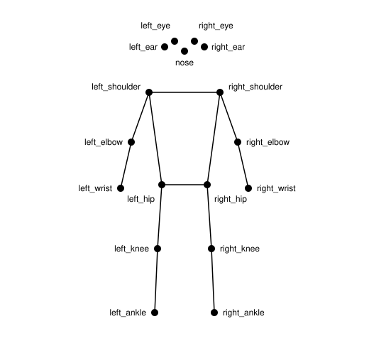

# Type of Motion — Starter Kits

Six small examples of type that moves with your body.

| Folder           | Input                | What happens                                        |
| ---------------- | -------------------- | --------------------------------------------------- |
| `01-mouse-touch` | mouse / finger       | a variable font changes its axes                    |
| `02-body`        | camera, ml5 bodyPose | your shoulders and body build a T from shapes      |
| `03-face`        | camera, ml5 faceMesh | mouth + eyebrow build an a from a circle and a rect |
| `04-hand`        | camera, ml5 handPose | thumb–index distance resizes a word                 |
| `05-nose`        | camera, ml5 bodyPose | your nose draws a track of letters                  |
| `06-body-trace`  | camera, ml5 bodyPose | dots and lines of your pose leave a trace           |

Every example is one folder with an `index.html` and a `sketch.js` (01: `main.js`).
Start with one, copy the folder, and change it.

## Example 01: variable font

[**Times New Arial**](https://timesnewarial.liebermannkiepereddemann.de/) is a variable font
concept by Liebermann Kiepe Reddemann produced by [Elias Hanzer](https://www.eliashanzer.com).
See [`01-mouse-touch/README.md`](01-mouse-touch/README.md) for how variable fonts work
and how to use your own.

## Examples 02–06: body tracking + type

Every `sketch.js` is short and has the same parts:

```
SETTINGS   → what you can change: word, font, colours, thickness …
SETUP      → start the camera and the model
DRAW       → runs ~60 times per second: find the points, draw the type
```

The canvas is 640 × 480 pixels, the same size as the video,
so the points from ml5 can be used directly to draw.
CSS scales the canvas up to fill the window.

Things to try:

- change the settings at the top of `sketch.js`
- use other points, e.g. `pose.left_elbow` instead of `pose.left_wrist`
- **02:** add a circle on the head, build a different letter (an `L`? an `X` from both arms?)
- **03:** pick other face points from the [face mesh map](https://github.com/tensorflow/tfjs-models/blob/master/face-landmarks-detection/mesh_map.jpg), build an `o`, `b` or `d`
- **04:** use the distance for something else: `rotate()`, the colour, the number of letters
- **05:** draw with your wrist (`PEN_POINT = "right_wrist"`), draw a whole word,
  or add `background(255, 10)` at the start of `draw()` so the track slowly fades
- **06:** draw only some points (just the wrists?), or a letter on every point

## How pose recognition works



1. **Camera:** the webcam sends a new image many times per second.
2. **Model:** a neural network looks at each image. It was trained on
   thousands of photos of people, so it can guess where body parts are.
3. **Points:** for every body part it returns a point with
   `x`, `y` (position in the video) and `confidence` (0 … 1, how sure it is).
   bodyPose finds 17 points on the body (see image),
   handPose 21 per hand, faceMesh 468 on the face.
4. **Your code:** you measure something with these points (a distance,
   a height, an angle) or use them directly, and connect it
   to the type: a position, a size, a line.

Everything runs in your browser. The video is not uploaded anywhere.

The names in the image are the ones you use in the code, e.g. `pose.left_wrist.x`.
The image shows the mirror view used in the sketches: your left side is on the left.

More:

- [The Coding Train: Pose Detection with ml5.js bodyPose](https://thecodingtrain.com/tracks/ml5js-beginners-guide/ml5/7-bodypose/pose-detection) — video intro
- [The Coding Train: Hand Pose](https://thecodingtrain.com/tracks/ml5js-beginners-guide/ml5/hand-pose) and [Face Mesh](https://thecodingtrain.com/tracks/ml5js-beginners-guide/ml5/facemesh)
- [TensorFlow: Next-generation pose detection with MoveNet](https://blog.tensorflow.org/2021/05/next-generation-pose-detection-with-movenet-and-tensorflowjs.html) — the model behind bodyPose
- [MediaPipe: Hand landmarks](https://ai.google.dev/edge/mediapipe/solutions/vision/hand_landmarker) — image of all 21 hand points
- [Face mesh map](https://github.com/tensorflow/tfjs-models/blob/master/face-landmarks-detection/mesh_map.jpg) — all 468 face points with their numbers

Critical context:

- [Excavating AI: The Politics of Images in Machine Learning Training Sets](https://excavating.ai/) — Kate Crawford & Trevor Paglen (2019).
  How training datasets classify human bodies.

## How to run it

The examples need to run on a local server (not by double-clicking the file),
because the camera and the font only load properly that way.

In VS Code: install the extension _Live Server_,
right-click `index.html` → _Open with Live Server_.
It opens at <http://localhost:5500>.

The browser will ask for camera access in examples 02–06.
Loading the model takes a few seconds before anything appears.
`localhost` counts as secure, so the camera works on your laptop.

## Libraries

- [p5.js](https://p5js.org) 2.3.4 — camera and drawing (examples 02–06)
- [ml5.js](https://ml5js.org) 1.4.0 — pose recognition (examples 02–06)
  - [bodyPose](https://docs.ml5js.org/#/reference/bodypose)
  - [faceMesh](https://docs.ml5js.org/#/reference/facemesh)
  - [handPose](https://docs.ml5js.org/#/reference/handpose)

Example 01 uses plain JavaScript, no libraries.

## Examples

- **Typeface | Times New Arial** — mouse / touch\
  ↳ <https://timesnewarial.liebermannkiepereddemann.de/>
- **&amp;shy; | forever dolphin love II – *Hannah Schraven*** — mouse / touch\
  ↳ <https://andshymagazine.com/mistakingglassforskin/hannahschraven/>
- **Experimental | Type of Motion** — variable font w/ pose recognition\
  ↳ <https://www.katharinanejdl.com/typeofmotion/>
- **Experimental | DriftDraw** — draw with your head\
  ↳ <https://katharinanejdl.com/driftdraw/>

## Resources

### Variable fonts

- [v-fonts](https://v-fonts.com) — collection of variable fonts to try and download
- [MDN: Variable fonts guide](https://developer.mozilla.org/en-US/docs/Web/CSS/CSS_fonts/Variable_fonts_guide) — the CSS behind it
- [Font Gauntlet](https://fontgauntlet.com) by ABC Dinamo — drop in a variable font, animate its axes

> **→ TUE 13.10.:** input session on p5.js and ml5.js.

### p5.js

- [p5.js reference](https://p5js.org/reference/) — every function, with examples
- [p5.js tutorials](https://p5js.org/tutorials/)

### ml5.js

- [ml5.js docs](https://docs.ml5js.org) — all models, with examples
- [The Coding Train: Beginner's Guide to ml5.js](https://thecodingtrain.com/tracks/ml5js-beginners-guide) — video series

### Creative coding

- [The Coding Train](https://thecodingtrain.com) — video tutorials by Daniel Shiffman
- [Generative Gestaltung](http://www.generative-gestaltung.de) — book + p5.js examples (German / English)
- [→ _Thoughts towards vibe-coding_](https://hfkbremen.sharepoint.com/:w:/s/S26BlockBTextTypeTools/cQrVSmIL7ODMSo9VGdRpfl-2EgUD1-pyCUHNydv1e8MlNIWOnQ)
